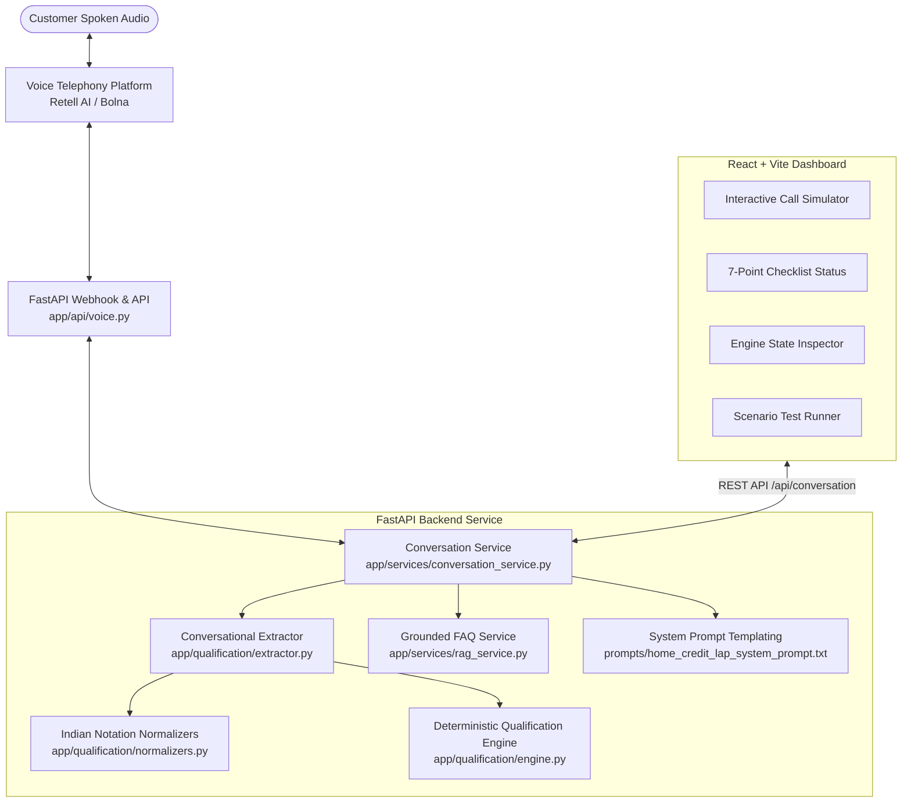
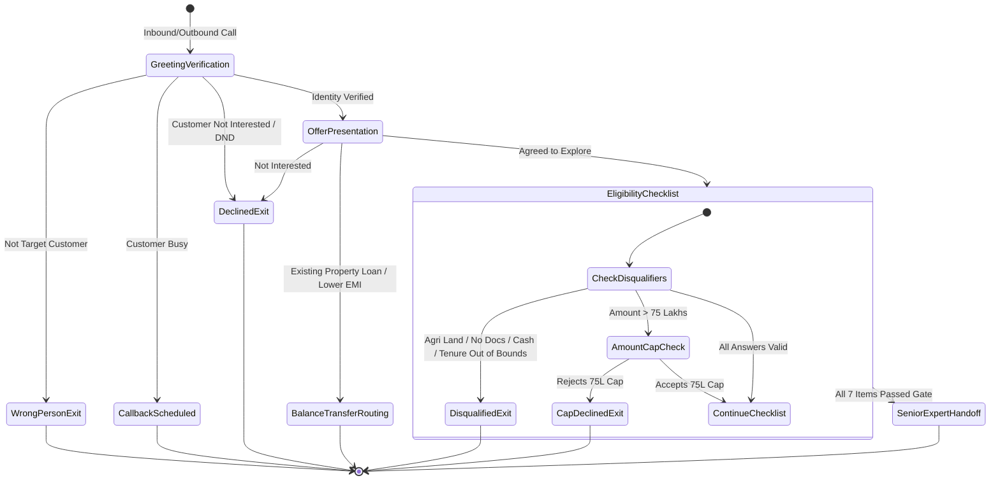

# Home Credit LAP Voice Agent — System Architecture

## 1. Overview & Architectural Principles

The **Home Credit Loan Against Property (LAP) AI Voice Agent** is engineered as a decoupled, resilient, telephony-ready conversational AI system. It automates preliminary borrower qualification while ensuring strict adherence to lending credit policies and regulatory compliance.

### Core Principles
1. **Deterministic Rule Enforcement:** Business logic, loan caps, tenures, and eligibility gates are evaluated through a pure deterministic engine rather than probabilistic LLM hallucinations.
2. **Robust Natural Language Fact Extraction:** Out-of-order information, multi-fact utterances, interruptions, and verbal corrections are smoothly extracted into structured state.
3. **Decoupled Telephony Interface:** Voice platforms (Retell AI, Bolna) interact through modular adapters and cryptographically signed webhooks.
4. **Zero Information Leakage:** Financial offers are guarded behind customer verification. Internal reasoning and secrets are never committed or exposed to borrowers.

---

## 2. Component Diagram

---

## 3. Qualification Engine & State Flow

---

## 4. Subsystem Breakdown

### 4.1 Backend Engine (`backend/app`)
- **`qualification/rules.py`**: Constants (`MAX_LOAN_AMOUNT = 75,00,000`, `MIN_TENURE = 3`, `MAX_TENURE = 15`) and disqualification predicates.
- **`qualification/normalizers.py`**: Indian numbering notation parser (`60 lakh`, `1.5 crore`, `roughly one crore twenty`), property type categorizer, document availability validator, tenure parser with correction handling.
- **`qualification/engine.py`**: Pure business rule evaluator and the Senior Loan Expert handoff gate.
- **`qualification/extractor.py`**: Out-of-order conversational parser that extracts multiple facts in a single customer turn.
- **`services/conversation_service.py`**: Session state coordinator, dynamic Jinja prompt renderer with 11 runtime variables, and spoken telephony response generator.
- **`services/rag_service.py`**: Grounded borrower FAQ knowledge base (interest rates, processing fees, documentation requirements) that answers succinctly without fabricating numbers.

### 4.2 Telephony Integration Layer (`backend/app/voice`)
- **`adapter_base.py`**: Standard interface for voice telephony platforms.
- **`retell_adapter.py`**: Retell AI schema exporter, call status listener, and recording/transcript mapper.
- **`webhook_verifier.py`**: Constant-time HMAC-SHA256 signature verification.

### 4.3 Conversational Dashboard (`frontend/src`)
- **Vite + React 18**: High-performance, reactive testing interface.
- **Interactive Call Simulator**: Real-time voice simulation with conversational chips and terminal outcome flags.
- **7-Point Checklist Monitor**: Live visual tracking of all checklist items with pass/clarify/ineligible badges.
- **Scenario Runner**: One-click execution of 16+ synthetic customer scenarios.
- **Transcript Viewer**: Instant text and JSON export for QA audits.
